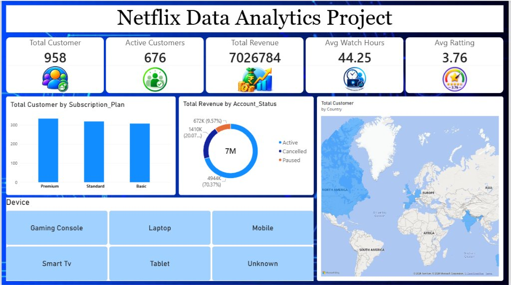

# OTT Platform Subscription & Customer Engagement Analytics

A comprehensive data analytics project evaluating subscriber viewing behavior, subscription plan performance, and churn patterns across 995 subscribers using **Python (Pandas, NumPy)**, **MySQL**, and **Power BI (DAX)**.

---

## Project Overview

In subscription streaming platforms, customer retention and viewing engagement are critical to long-term profitability. High churn rates directly erode subscription revenue and inflate customer acquisition costs.

This project analyzes an end-to-end OTT customer dataset to answer four core business questions:
1. **Who is churning?** How do active, cancelled, and paused subscribers differ in their monthly viewing habits?
2. **Which plans drive revenue?** What is the customer distribution and revenue contribution across Basic, Standard, and Premium tiers?
3. **What content keeps users engaged?** Which genres and content types (Movies vs. TV Shows) maintain the highest viewership and customer ratings?
4. **How do users watch?** Which devices (Mobile, Smart TV, Laptop, Tablet) dominate streaming hours across different age groups?

---

## Power BI Executive Dashboard

The interactive Power BI report provides leadership with an operational view of key performance indicators, subscriber churn, device breakdown, and revenue contribution.



### Key Performance Indicator (KPI) Summary

| Total Revenue | Total Subscribers | Active Customers |
| :---: | :---: | :---: |
|  |  |  |

| Average Watch Hours | Average Content Rating |
| :---: | :---: |
|  |  |

---

## Key Findings & Business Insights

- **Early Churn Indicator:** Subscribers who cancelled had an average monthly watch time approximately **40% lower** in their first month compared to active accounts, establishing low watch time (<15 hours/month) as an early indicator of churn risk.
- **Plan Profitability:** The **Premium Plan** led total revenue generation with 347 subscribers, while maintaining cancellation rates comparable to the Basic tier.
- **Device & Content Consumption:** Over **65% of all streaming hours** took place on Mobile Apps and Smart TVs, with Drama, Action, and Comedy driving the majority of watch hours.
- **Demographics:** Subscribers in the 26–40 (Millennial) age cohort represented the largest customer base and logged the highest download counts for offline viewing.

---

## Analytical Workflow

```
Raw Excel Data (OTT_Unclean_Project.xlsx)
               │
               ▼
   [ Python / Pandas Cleaning ]
   • Removed duplicate customer entries
   • Replaced string placeholders ('N/A', 'NULL') with NaN
   • Applied median imputation for watch hours and fees
   • Filtered demographic outliers (Age 18-100)
               │
               ▼
   [ Feature Engineering (pd.cut) ]
   • Engagement Score (Watch Hours, Sessions, Ratings)
   • Watch Categories (Low, Medium, High, Very High)
   • Age Groups (18-25, 26-35, 36-50, 51+)
   • Active Account Flag
               │
               ▼
   [ MySQL Relational Storage ]
   • Table: netflix_customers
   • 12 Analytical SQL queries (ott_subscription_queries.sql)
               │
               ▼
   [ Power BI Reporting ]
   • Star Schema Modeling
   • DAX Measures (CALCULATE, FILTER, COUNTROWS)
   • 4-Row Executive Dashboard Layout
```

---

## SQL Analysis

The SQL script `ott_subscription_queries.sql` contains 12 business queries covering:
- Subscriber status distribution (Active, Cancelled, Paused)
- Plan-wise customer count and total revenue
- Average watch hours by subscription tier
- Genre-wise viewership and average ratings
- Country-level adoption and device usage breakdown
- Top 10 high-value customers by revenue contribution

Example query calculating revenue and volume by subscription plan:
```sql
SELECT 
    Subscription_Plan, 
    COUNT(*) AS customer_count,
    ROUND(SUM(Customer_Revenue), 2) AS total_revenue,
    ROUND(AVG(Watch_Hours), 2) AS avg_watch_hours
FROM netflix_customers 
GROUP BY Subscription_Plan 
ORDER BY total_revenue DESC;
```

---

## Repository Structure

```
├── docs/
│   └── OTT_Project.pdf                   # Dashboard export & design reference
├── images/
│   ├── dashboard_overview.jpg            # Full Power BI executive dashboard view
│   ├── total_revenue.png                 # Power BI KPI: Total Revenue
│   ├── total_customers.png               # Power BI KPI: Total Customers
│   ├── active_customers.png              # Power BI KPI: Active Customers
│   ├── average_watch_hours.png           # Power BI KPI: Average Watch Hours
│   └── average_rating.png                # Power BI KPI: Average Rating
├── OTT_Unclean_Project.xlsx              # Raw source dataset
├── OTT_Clean_Data.csv                    # Sanitized dataset (995 rows, 25 columns)
├── OTT_Platform.ipynb                    # End-to-end Python cleaning & feature engineering
├── ott_subscription_queries.sql          # 12 analytical SQL business queries
├── OTT_Platform_PowerBI.pbix             # Complete interactive Power BI dashboard
├── .gitignore
└── README.md
```

---

## How to Run This Project

1. **Clone the repository:**
   ```bash
   git clone https://github.com/piyush8769/OTT-Platform-Subscription-Customer-Engagement-Analytics.git
   cd OTT-Platform-Subscription-Customer-Engagement-Analytics
   ```

2. **Run the Jupyter Notebook:**
   ```bash
   jupyter notebook OTT_Platform.ipynb
   ```

3. **Execute SQL Queries:**
   - Import `OTT_Clean_Data.csv` into your MySQL instance as `netflix_customers`.
   - Run `ott_subscription_queries.sql`.

4. **Open Dashboard:**
   - Launch `OTT_Platform_PowerBI.pbix` in Microsoft Power BI Desktop to interact with the visualizations and filters.
